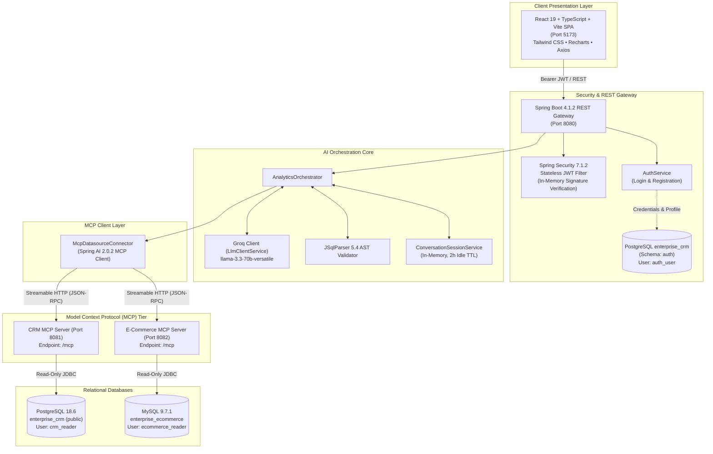
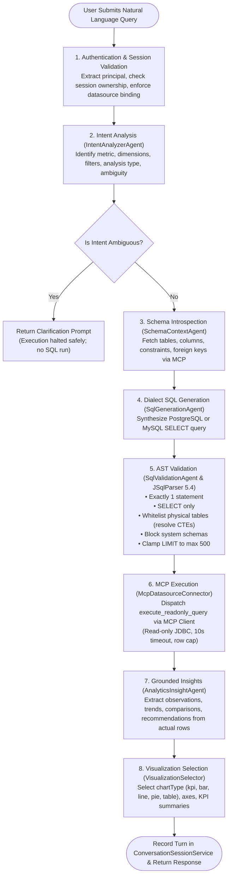
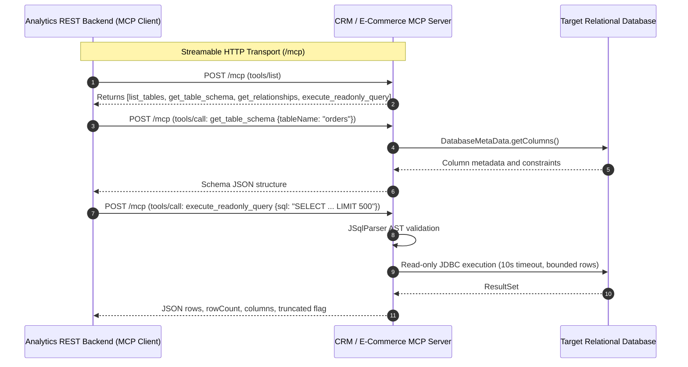

# Agentic Analytics Platform for Enterprise Applications

[](https://openjdk.org/)
[](https://spring.io/projects/spring-boot)
[](https://spring.io/projects/spring-ai)
[](https://modelcontextprotocol.io/)
[](https://react.dev/)
[](https://www.typescriptlang.org/)

A full-stack natural-language analytics platform. Built on **Spring AI 2.0.2**, **Spring Boot 4.1.2**, and the **Model Context Protocol (MCP)**, the platform allows business users to query heterogeneous operational databases using natural language. A coordinated multi-agent pipeline introspects live database schemas over MCP, synthesizes dialect-aware SQL, validates syntax trees with JSqlParser 5.4, executes read-only queries against isolated MCP database servers, extracts grounded insights, and generates visual analytics.

---

## Table of Contents

- [Problem Statement & Motivation](#problem-statement--motivation)
- [System Architecture](#system-architecture)
- [AI Agent Pipeline & Workflow](#ai-agent-pipeline--workflow)
- [Model Context Protocol (MCP) Architecture](#model-context-protocol-mcp-architecture)
- [Implemented Features](#implemented-features)
- [Technology Stack](#technology-stack)
- [Authentication & Security Architecture](#authentication--security-architecture)
- [SQL Safety & Defense-in-Depth](#sql-safety--defense-in-depth)
- [Database Schemas & Sample Datasets](#database-schemas--sample-datasets)
- [Frontend Workspace](#frontend-workspace)
- [Directory Structure](#directory-structure)
- [Prerequisites & Environment Setup](#prerequisites--environment-setup)
- [Execution Guide](#execution-guide)
- [Environment Variables Reference](#environment-variables-reference)
- [REST API Reference](#rest-api-reference)
- [Test Suite & Verification](#test-suite--verification)
- [Known Limitations](#known-limitations)
- [Future Roadmap](#future-roadmap)
- [Contributing](#contributing)

---

## Problem Statement & Motivation

Enterprise business intelligence often suffers from friction and security risks:

1. **SQL Dependency**: Business analysts must write manual SQL or rely on engineering teams for cross-table aggregations.
2. **Schema Drift**: Traditional text-to-SQL setups use static prompts that break when database schemas change.
3. **LLM Query Vulnerabilities**: Unchecked LLM SQL generation risks destructive DDL/DML, system catalog enumeration, or runaway full-table scans.
4. **Data Isolation Across Systems**: Organizations maintain distinct databases (e.g., PostgreSQL for CRM, MySQL for E-Commerce) with divergent dialects, connection credentials, and schemas.

### The Solution

- **Dynamic Schema Discovery**: Databases expose metadata through Spring AI MCP servers (`list_tables`, `get_table_schema`, `get_relationships`), giving agents real-time schema awareness.
- **AST Security Verification**: Every generated query is parsed with JSqlParser 5.4 to enforce a single `SELECT`, validate physical tables against schema whitelists, resolve CTE aliases, block system schemas, and clamp row limits.
- **Evidence-Grounded Insights**: Narrative summaries and observations are grounded strictly in returned query data, reducing unsupported claims.
- **Enterprise RBAC & Per-User Session Isolation**: Spring Security 7.1.2 stateless JWT authentication with role-based access controls (`ADMIN`, `ANALYST`, `VIEWER`) and session ownership validation prevents cross-user context leakage.

---

## System Architecture



---

## AI Agent Pipeline & Workflow

The platform coordinates **six specialized AI agents**, supported by orchestration and infrastructure services:



### AI Pipeline Components

- **Specialized AI Agents** (in `com.analytics.agent.agent`):
  1. `IntentAnalyzerAgent`: Identifies analytical intent, dimensions, filters, date range, and ambiguity.
  2. `SchemaContextAgent`: Gathers live metadata across target datasources using MCP tools.
  3. `SqlGenerationAgent`: Generates dialect-accurate SQL compliant with target constraints.
  4. `SqlValidationAgent`: Parses SQL AST with JSqlParser 5.4, resolving CTE aliases, verifying physical tables, blocking system catalogs, and clamping row limits.
  5. `AnalyticsInsightAgent`: Synthesizes evidence-grounded observations, trends, comparisons, and recommendations strictly from returned rows.
  6. `VisualizationSelector`: Determines optimal visualization format (`kpi`, `bar`, `line`, `pie`, `table`) and aggregates KPIs.
- **Orchestration & Infrastructure Services**:
  - `AnalyticsOrchestrator` (in `com.analytics.agent.orchestrator`): Coordinates the eight workflow stages.
  - `ConversationSessionService` (in `com.analytics.agent.service`): Manages multi-turn conversation memory with a 2-hour idle TTL, datasource immutability, and user isolation.
  - `LlmClientService` (in `com.analytics.agent.service`): Manages the Groq LLM client and validates runtime configuration.
  - `McpDatasourceConnector` (in `com.analytics.datasource`): Implements `DatasourceConnector` as an MCP client invoking remote tools.

> [!IMPORTANT]
> **Datasource Session Binding**: A conversation session is permanently bound to its initial datasource (`crm` or `ecommerce`). Switching datasources requires initiating a new session; passing a mismatched datasource ID throws an `IllegalArgumentException`.

---

## Model Context Protocol (MCP) Architecture

Database communication uses the **Spring AI 2.0.2 MCP Streamable HTTP** transport. The backend functions as an MCP Client invoking tools exposed by independent Spring Boot MCP servers over HTTP POST (`/mcp`).



### Standardized MCP Tool Contracts

Both `crm-mcp-server` and `ecommerce-mcp-server` provide identical MCP tool interfaces:

1. `list_tables`: Lists all tables in the active schema (`public` for CRM; catalog for E-Commerce).
2. `get_table_schema`: Returns column names, SQL types, nullability, defaults, and primary key flags.
3. `get_relationships`: Details foreign key relationships, referencing and referenced columns.
4. `execute_readonly_query`: Executes a single verified read-only `SELECT`. Re-validates AST with JSqlParser, sets `connection.setReadOnly(true)`, applies a 10-second statement timeout, and caps result sets at the server maximum (default: 500).

---

## Implemented Features

- **Dual Database Analytics**: Introspects and queries PostgreSQL (CRM) and MySQL (E-Commerce).
- **Conversational AI Analytics**: Multi-turn natural language query workspace with prompt templates and execution timing.
- **Visual Analytics Engine**: Automatic chart selection (`kpi`, `bar`, `line`, `pie`, `table`) powered by Recharts, complete with table pagination and sorting.
- **SQL Workspace**: Manual SQL editor with dialect templates, row limit selector (10–500), and privilege-aware execution buttons.
- **Live Schema Explorer**: Real-time schema inspector displaying tables, column data types, constraints, and entity relationships.
- **Enterprise RBAC**: Stateless JWT authentication with role-based endpoint protection and per-user session ownership and isolation.

---

## Technology Stack

| Layer | Component | Version | Description |
| :--- | :--- | :--- | :--- |
| **Backend** | Java | 21 (LTS) | Enterprise Java runtime. |
| | Spring Boot | 4.1.2 | Core application framework. |
| | Spring AI | 2.0.2 | MCP Client and Server starters. |
| | Spring Security | 7.1.2 | Stateless security filter chain and OAuth2 resource server. |
| | Nimbus JOSE + JWT | BOM-managed | JWT signing, verification, and decoding. |
| | JSqlParser | 5.4 | SQL Abstract Syntax Tree inspection and validation. |
| | Spring Data JPA | 4.1.2 | Persistence for user authentication entities. |
| **LLM Provider** | Groq Cloud API | OpenAI-compatible | Fast inference (`llama-3.3-70b-versatile`). |
| **Frontend** | React | 19.3.1 | Declarative UI library. |
| | TypeScript | 7.0.2 | Typed JavaScript application layer. |
| | Vite | 8.3.8 | Build tooling and development server. |
| | Tailwind CSS | 4.3.5 | Utility-first CSS framework. |
| | Recharts | 3.10.1 | Composable charting library. |
| | Axios | 1.21.1 | HTTP client with JWT interceptors. |
| | Icons | Custom SVG | Inline accessible SVG components. |
| **Databases** | PostgreSQL | 18.6 | Enterprise CRM database and dedicated `auth` schema. |
| | MySQL | 9.7.1 | Enterprise E-Commerce database. |

---

## Authentication & Security Architecture

Governed by **Spring Security 7.1.2** using stateless Bearer JWTs (HMAC-SHA256, 256-bit secret key). Tokens are decoded and validated in memory by `NimbusJwtDecoder` without database lookups on authenticated requests; database queries to `auth.users` occur only during user registration, credential verification at login, or profile lookups.

### Role-Based Access Control (RBAC) Matrix

| Endpoint | Method | Public | VIEWER | ANALYST | ADMIN |
| :--- | :---: | :---: | :---: | :---: | :---: |
| `/api/auth/register` | `POST` | Yes | Yes | Yes | Yes |
| `/api/auth/login` | `POST` | Yes | Yes | Yes | Yes |
| `/actuator/health`, `/actuator/info` | `GET` | Yes | Yes | Yes | Yes |
| `/api/auth/me` | `GET` | No | Yes | Yes | Yes |
| `/api/datasources/**` | `GET` | No | Yes | Yes | Yes |
| `/api/analytics/query` | `POST` | No | Yes | Yes | Yes |
| `/api/datasources/{id}/query` *(Manual SQL)* | `POST` | No | No (403) | Yes | Yes |
| `/actuator/**` *(Admin Actuators)* | `GET` | No | No (403) | No (403) | Yes |

### Token Expiration and Session TTL

- **JWT Lifetime**: **24 hours** (`86,400,000` ms), configured via `security.jwt.expiration-ms`.
- **In-Memory Session TTL**: **2 hours** idle expiration (`Duration.ofHours(2)` in `ConversationSessionService`). Inactive sessions are automatically cleaned up.
- **Session Ownership Isolation**: Every conversation session records its `ownerUserId`. Any request to retrieve or update a session with a different authenticated user ID triggers an immediate `AccessDeniedException` (HTTP 403 Forbidden).

### Database Privilege Separation & Admin Promotion

1. `auth_user` (PostgreSQL): Granted `USAGE` and `CREATE` on schema `auth`, and table/sequence privileges on `auth.users` for authentication management; all access to schema `public` (CRM operational tables) is explicitly revoked.
2. `crm_reader` (PostgreSQL): Read-only (`SELECT`) on `public.*`; access to `auth.*` is revoked.
3. `ecommerce_reader` (MySQL): Read-only (`SELECT`) on `enterprise_ecommerce.*`.
4. **Initial Admin Provisioning**: Public registration assigns the `ANALYST` role by default. Initial `ADMIN` accounts are provisioned via direct DBA SQL:
   ```sql
   UPDATE auth.users SET role = 'ADMIN', updated_at = CURRENT_TIMESTAMP WHERE username = 'admin_username';
   ```

---

## SQL Safety & Defense-in-Depth

The platform validates every SQL statement at two separate execution points:

1. **Gateway Validation (`SqlValidationAgent`)**:
   - Parses statement via JSqlParser 5.4.
   - Enforces exactly one statement; must be a `Select`.
   - Identifies Common Table Expressions (`WITH ... AS (...)`) to resolve temporary CTE aliases without bypassing table checks.
   - Validates that all physical tables exist in the target datasource schema whitelist.
   - Rejects system catalogs (`auth`, `information_schema`, `pg_catalog`, `mysql`, `performance_schema`, `sys`).
   - Clamps any user/LLM `LIMIT` to 500, or injects `LIMIT 500` if omitted.
2. **MCP Server Enforcement (`CrmDatabaseTools` / `EcommerceDatabaseTools`)**:
   - Re-verifies AST using JSqlParser before execution.
   - Disallows `FOR UPDATE` locking clauses and `SELECT INTO` constructs.
   - Sets `connection.setReadOnly(true)` and `connection.setAutoCommit(false)`.
   - Sets query timeout (`statement.setQueryTimeout(10)`).
   - Sets statement row cap (`statement.setMaxRows(limit + 1)`) with truncation detection.

---

## Database Schemas & Sample Datasets

### 1. CRM Database (`enterprise_crm` — PostgreSQL 18.6)
Contains 228 verified relational rows across four tables:
- `customers` (24 rows): Enterprise accounts (`Technology`, `Healthcare`, `Finance`, `Manufacturing`, `Retail`, `Professional Services`).
- `leads` (48 rows): Inquiries categorized by source and status.
- `opportunities` (36 rows): Pipeline deals across six stages (`qualification` to `closed_won`/`closed_lost`).
- `activities` (120 rows): Touchpoints (`call`, `email`, `meeting`, `demo`, `task`).

### 2. E-Commerce Database (`enterprise_ecommerce` — MySQL 9.7.1)
Contains 2,208 verified records across five tables:
- `customers` (24 rows): Customers across 12 countries.
- `products` (24 rows): Products categorized across **`Electronics`**, **`Home`**, **`Apparel`**, **`Sports`**, and **`Books`**.
- `orders` (540 rows): 540 orders spanning over 12 months.
- `order_items` (1,080 rows): Multi-item purchase lines.
- `payments` (540 rows): Payment records via card, digital wallet, bank transfer, and buy-now-pay-later.
- *Verified Metrics*: Total order value and settled payments equal **\$177,523.00** across 540 orders (\$328.75 average order value).

### 3. Authentication Schema (`enterprise_crm.auth` — PostgreSQL 18.6)
- `auth.users`: Stores user identity, BCrypt hashes, enabled flags, and role assignments (`ADMIN`, `ANALYST`, `VIEWER`).

---

## Frontend Workspace

The frontend is a single-page application built with React 19, TypeScript, and Tailwind CSS.

- **Query Processing**: Submitting a natural language prompt initiates a synchronous HTTP POST (`/api/analytics/query`). While the backend processes the request, the frontend displays an animated loading indicator.
- **Five Dedicated Tabs**:
  1. `ai`: Conversational analytics interface with starter prompts, interactive Recharts visualizations, KPI highlights, collapsible SQL inspection drawer, and evidence summaries.
  2. `overview`: Live connection and tool health monitors for CRM and E-Commerce MCP servers.
  3. `sql`: Manual SQL query editor with dialect templates, row limit bounds, and privilege-checked execution controls.
  4. `analytics`: Visual exploration workspace with chart-type selection (`kpi`, `bar`, `line`, `pie`, `table`) and axis mapping.
  5. `schema`: Metadata viewer with table schemas, column types, constraints, and foreign key relations.

---

## Directory Structure

```
Agentic_Analysis/
├── .env.example                               # Environment variable template
├── pom.xml                                    # Multi-module Maven POM
├── README.md                                  # Architectural documentation
│
├── backend/                                   # Spring Boot REST Gateway (Port 8080)
│   ├── pom.xml
│   └── src/main/java/com/analytics/
│       ├── agent/                             # AI Orchestration Core
│       │   ├── agent/                         # 6 Specialized AI Agents
│       │   │   ├── AnalyticsInsightAgent.java
│       │   │   ├── IntentAnalyzerAgent.java
│       │   │   ├── SchemaContextAgent.java
│       │   │   ├── SqlGenerationAgent.java
│       │   │   ├── SqlValidationAgent.java
│       │   │   └── VisualizationSelector.java
│       │   ├── dto/                           # Query, Intent, and Response Records
│       │   ├── orchestrator/                  # AnalyticsOrchestrator
│       │   └── service/                       # ConversationSessionService & LlmClientService
│       ├── controller/                        # AnalyticsController & DatasourceController
│       ├── datasource/                        # McpDatasourceConnector & Registry
│       └── security/                          # Spring Security 7.1.2 & JWT Implementation
│
├── mcp-servers/
│   ├── crm-mcp-server/                        # PostgreSQL CRM MCP Server (Port 8081)
│   │   └── src/main/java/com/analytics/crm/CrmDatabaseTools.java
│   └── ecommerce-mcp-server/                  # MySQL E-Commerce MCP Server (Port 8082)
│       └── src/main/java/com/analytics/ecommerce/EcommerceDatabaseTools.java
│
├── frontend/                                  # React 19 + TypeScript SPA (Port 5173)
│   ├── package.json
│   └── src/
│       ├── components/                        # AI Workspace, SQL Editor, Schema Viewer
│       ├── context/AuthContext.tsx            # Auth State & RBAC Context
│       └── services/api.ts                    # Axios API Client & Interceptors
│
└── database/                                  # Database Schemas & Deterministic Seeds
    ├── auth/schema.sql                        # Dedicated auth schema & auth_user
    ├── crm/                                   # PostgreSQL enterprise_crm DDL & Seed
    └── ecommerce/                             # MySQL enterprise_ecommerce DDL & Seed
```

---

## Prerequisites & Environment Setup

### Prerequisites
- **Java JDK**: 21+ (`java -version`)
- **Maven**: 3.9+ (`mvn -version`)
- **Node.js & npm**: Node 20+, npm 10+ (`node -v; npm -v`)
- **PostgreSQL**: 16+ (tested on 18.6)
- **MySQL Server**: 8.0+ (tested on 9.7.1)
- **Groq API Key**: Required for natural language SQL generation and insight synthesis

### Database Initialization

1. Create a `.env` file from `.env.example` and populate your secrets:
   ```powershell
   Copy-Item .env.example .env
   ```

2. Load the `.env` variables into your active PowerShell session:
   ```powershell
   Get-Content .env | ForEach-Object {
     if ($_ -match '^([A-Z0-9_]+)=(.*)$') {
       [Environment]::SetEnvironmentVariable($Matches[1], $Matches[2], 'Process')
     }
   }
   ```

3. Initialize PostgreSQL CRM and Auth schemas:
   ```powershell
   $crmUri = [Uri]($env:CRM_DB_URL -replace '^jdbc:', '')
   $crmPort = if ($crmUri.Port -gt 0) { $crmUri.Port } else { 5432 }
   $crmAdminUrl = "postgresql://$($crmUri.Host):$crmPort/postgres$($crmUri.Query)"
   $env:PGUSER = $env:CRM_ADMIN_DB_USERNAME
   $env:PGPASSWORD = $env:CRM_ADMIN_DB_PASSWORD

   psql $crmAdminUrl -X -v ON_ERROR_STOP=1 -f database/crm/schema.sql
   psql $crmAdminUrl -X -v ON_ERROR_STOP=1 -f database/crm/seed.sql
   psql $crmAdminUrl -X -v ON_ERROR_STOP=1 -f database/auth/schema.sql
   ```

4. Initialize MySQL E-Commerce schema:
   ```powershell
   $ecommerceUri = [Uri]($env:ECOMMERCE_DB_URL -replace '^jdbc:', '')
   $ecommercePort = if ($ecommerceUri.Port -gt 0) { $ecommerceUri.Port } else { 3306 }
   $env:MYSQL_PWD = $env:ECOMMERCE_ADMIN_DB_PASSWORD

   Get-Content -Raw database/ecommerce/schema.sql | mysql --protocol=TCP --host $ecommerceUri.Host --port $ecommercePort --user $env:ECOMMERCE_ADMIN_DB_USERNAME --default-character-set=utf8mb4
   Get-Content -Raw database/ecommerce/seed.sql | mysql --protocol=TCP --host $ecommerceUri.Host --port $ecommercePort --user $env:ECOMMERCE_ADMIN_DB_USERNAME --default-character-set=utf8mb4
   ```

---

## Execution Guide

Start the four services in separate PowerShell terminals in the following sequence:

### Terminal 1: CRM MCP Server (Port 8081)
```powershell
cd E:\Agentic_Analysis
mvn -pl mcp-servers/crm-mcp-server spring-boot:run
```

### Terminal 2: E-Commerce MCP Server (Port 8082)
```powershell
cd E:\Agentic_Analysis
mvn -pl mcp-servers/ecommerce-mcp-server spring-boot:run
```

### Terminal 3: Analytics REST Backend (Port 8080)
```powershell
cd E:\Agentic_Analysis
mvn -pl backend spring-boot:run
```
*Health Check*: Verify `http://127.0.0.1:8080/actuator/health` returns `{"status":"UP"}`.

### Terminal 4: Frontend Application (Port 5173)
```powershell
cd E:\Agentic_Analysis\frontend
npm install
npm run dev
```
*Access*: Open `http://localhost:5173` in your browser.

---

## Environment Variables Reference

| Variable Name | Required | Default | Description |
| :--- | :---: | :--- | :--- |
| `API_PORT` | No | `8080` | Port for the main REST backend gateway. |
| `CRM_MCP_PORT` | No | `8081` | Port for the PostgreSQL CRM MCP server. |
| `ECOMMERCE_MCP_PORT` | No | `8082` | Port for the MySQL E-Commerce MCP server. |
| `GROQ_API_KEY` | **Yes** | *(None)* | Groq API Key for LLM inference. |
| `GROQ_MODEL` | No | `llama-3.3-70b-versatile` | LLM model identifier. |
| `GROQ_BASE_URL` | No | `https://api.groq.com/openai/v1` | Groq OpenAI-compatible base URL. |
| `JWT_SECRET` | **Yes** | *(None)* | Secret key for signing HMAC-SHA256 tokens (min 256 bits). |
| `JWT_EXPIRATION_MS` | No | `86400000` (24h) | JWT expiration time in milliseconds. |
| `CORS_ALLOWED_ORIGINS`| No | `http://localhost:5173,...` | Allowed frontend origins for CORS. |
| `AUTH_DB_URL` | No | `jdbc:postgresql://localhost:5432/enterprise_crm?currentSchema=auth` | Auth schema JDBC URL. |
| `AUTH_DB_USERNAME` | No | `auth_user` | Dedicated PostgreSQL account for auth schema. |
| `AUTH_DB_PASSWORD` | **Yes** | *(None)* | Password for `auth_user`. |
| `CRM_DB_URL` | No | `jdbc:postgresql://localhost:5432/enterprise_crm` | CRM database JDBC URL. |
| `CRM_DB_USERNAME` | No | `crm_reader` | Read-only PostgreSQL account for CRM tables. |
| `CRM_DB_PASSWORD` | **Yes** | *(None)* | Password for `crm_reader`. |
| `ECOMMERCE_DB_URL` | No | `jdbc:mysql://localhost:3306/enterprise_ecommerce` | E-Commerce database JDBC URL. |
| `ECOMMERCE_DB_USERNAME`| No | `ecommerce_reader` | Read-only MySQL account for E-Commerce tables. |
| `ECOMMERCE_DB_PASSWORD`| **Yes** | *(None)* | Password for `ecommerce_reader`. |
| `MCP_QUERY_TIMEOUT_SECONDS` | No | `10` | Timeout cap in seconds for MCP query execution. |
| `MCP_QUERY_MAX_ROWS` | No | `500` | Hard cap on rows returned by MCP queries. |

---

## REST API Reference

All protected endpoints require an `Authorization: Bearer <token>` header.

### Authentication Endpoints
- `POST /api/auth/register` (Public): Registers a user (defaults to `ANALYST`). Accepts `username`, `email`, `password`.
- `POST /api/auth/login` (Public): Authenticates credentials. Accepts `identifier` (username/email) and `password`. Returns JWT `token`, `username`, `email`, and `role`.
- `GET /api/auth/me` (Authenticated): Returns current user profile.

### Datasource Endpoints
- `GET /api/datasources` (Authenticated): Returns list of registered datasources and their MCP status.
- `GET /api/datasources/{id}/tables` (Authenticated): Lists tables for the datasource.
- `GET /api/datasources/{id}/tables/{tableName}` (Authenticated): Returns column metadata for a table.
- `GET /api/datasources/{id}/relationships` (Authenticated): Returns foreign key relationships.
- `POST /api/datasources/{id}/query` (Restricted: `ADMIN`, `ANALYST`): Executes manual read-only SQL query with `sql` and optional `rowLimit`.

### AI Analytics Query Endpoint
- `POST /api/analytics/query` (Authenticated: `ADMIN`, `ANALYST`, `VIEWER`): Submits a natural language analytics query.

#### Request Structure (`AnalyticsQueryRequest`)
```json
{
  "question": "string (required)",
  "datasourceId": "string (optional; e.g. 'ecommerce' or 'crm')",
  "sessionId": "string (optional; UUID)"
}
```

#### Response Structure (`AnalyticsQueryResponse`)
The response maps directly to Java record definitions:
- `sessionId` (String): Active conversation session identifier.
- `question` (String): Submitted question.
- `datasourceId` (String): Target datasource ID.
- `datasourceName` (String): Display name of the datasource.
- `intent` (Object - `QueryIntent`): `datasourceId`, `businessMetric`, `dimensions`, `filters`, `dateRange`, `aggregation`, `analysisType`, `ambiguous`, `clarificationMessage`.
- `sql` (String): Validated SQL query executed.
- `columns` (List\<String\>): Output column labels.
- `rows` (List\<Map\<String, Object\>\>): Returned row records.
- `rowCount` (int): Number of returned rows.
- `truncated` (boolean): Whether results reached the row limit.
- `visualization` (Object - `VisualizationConfig`): `chartType` (`kpi`, `bar`, `line`, `pie`, `table`), `xAxisColumn`, `yAxisColumn`, `title`, `kpis` (list of `KpiItem` with `label`, `value`, `rawValue`, `format`).
- `insights` (Object - `EvidenceInsight`): `summary`, `observations`, `trends`, `comparisons`, `recommendations`.
- `metadata` (Object - `ExecutionMetadata`): `executionTimeMs`, `llmModel`, `databaseEngine`.
- `clarificationNeeded` (boolean): Flag indicating whether the question requires user clarification.
- `clarificationPrompt` (String): Clarification guidance if ambiguous, or `null`.

#### Illustrative Response Payload
*(Illustrative schema example reflecting exact Java record serialization with placeholder values and explicit illustrative constant annotations)*
```json
{
  "sessionId": "<session-uuid>",
  "question": "<natural-language-question>",
  "datasourceId": "<datasource-id>",
  "datasourceName": "<datasource-display-name>",
  "intent": {
    "datasourceId": "<datasource-id>",
    "businessMetric": "<metric-name>",
    "dimensions": ["<dimension-column>"],
    "filters": ["<filter-expression>"],
    "dateRange": "<date-range-or-null>",
    "aggregation": "<aggregation-function>",
    "analysisType": "<analysis-type>",
    "ambiguous": false /* illustrative boolean */,
    "clarificationMessage": null
  },
  "sql": "<validated-dialect-select-sql>",
  "columns": ["<column-1>", "<column-2>"],
  "rows": [
    {"<column-1>": "<example-value-1>", "<column-2>": "<example-value-2>"}
  ],
  "rowCount": 0 /* illustrative integer row count */,
  "truncated": false /* illustrative boolean flag */,
  "visualization": {
    "chartType": "line" /* illustrative chart type: kpi, bar, line, pie, or table */,
    "xAxisColumn": "<column-1>",
    "yAxisColumn": "<column-2>",
    "title": "<visualization-title>",
    "kpis": [
      {
        "label": "<kpi-label>",
        "value": "<formatted-kpi-value>",
        "rawValue": null /* illustrative Double or null */,
        "format": "<format-string-or-null>"
      }
    ]
  },
  "insights": {
    "summary": "<grounded-summary-derived-from-returned-rows>",
    "observations": ["<observation-grounded-in-rows>"],
    "trends": ["<trend-grounded-in-rows>"],
    "comparisons": [],
    "recommendations": ["<recommendation-grounded-in-rows>"]
  },
  "metadata": {
    "executionTimeMs": 0 /* illustrative execution duration in milliseconds */,
    "llmModel": "llama-3.3-70b-versatile",
    "databaseEngine": "<database-engine>"
  },
  "clarificationNeeded": false /* illustrative boolean */,
  "clarificationPrompt": null
}
```

---

## Test Suite & Verification

Run the full automated test suite across all reactor modules:
```powershell
mvn clean test
```

### Previously Verified Test Suite Status
*(Results from the comprehensive verification run across all reactor modules)*
- **Backend Tests (`backend`)**: **112 tests, 0 failures, 0 errors, 0 skipped** (previously verified).
  - `SecurityConfigIntegrationTest`: Validates route authorizations, permitAll endpoints, and 401/403 responses.
  - `JwtAuthenticationTest`: Verifies HMAC-SHA256 signature enforcement, claim extraction, and token expiration.
  - `DatasourceControllerSecurityTest`: Enforces role restrictions (`VIEWER` cannot execute manual SQL).
  - `ConversationSessionSecurityTest`: Confirms cross-user session tampering throws `AccessDeniedException`.
  - `SqlValidationAgentTest`: Validates JSqlParser AST parsing, CTE resolution, limit clamping, and DML rejection.
  - `AnalyticsOrchestratorTest`: Validates end-to-end multi-agent orchestration.
- **CRM MCP Server Tests**: **3 integration tests, 0 failures** (previously verified).
- **E-Commerce MCP Server Tests**: **3 integration tests, 0 failures** (previously verified).
- **Frontend Production Build**: `npm run build` previously verified compiling cleanly with zero TypeScript errors.

---

## UI Screenshots

*Screenshots of the conversational workspace, SQL editor, and schema explorer will be added in a future update.*

---

## Known Limitations

1. **In-Memory Session Storage**: Conversation sessions are held in memory (`ConcurrentHashMap`) with a 2-hour idle TTL. Server restarts clear active conversational memory.
2. **Datasource Immutability**: Sessions are permanently bound to the first datasource queried. Querying another datasource requires starting a new session.
3. **Single-Statement Limit**: The AST validator permits strictly one `SELECT` statement per invocation. Stacked or multi-statement queries are intentionally rejected.
4. **Groq Free-Tier Rate Limits**: High-concurrency query execution may encounter token-per-minute (TPM) limits on free Groq accounts.

---

## Future Roadmap

- [ ] **Persistent Session Storage**: Store conversation histories in PostgreSQL or Redis with configurable retention policies.
- [ ] **Cross-Datasource Analytics**: Enable federated agent queries combining CRM customer data with E-Commerce purchase history.
- [ ] **Text-to-SQL Evaluation Harness**: Establish an automated benchmarking harness measuring execution success rate, result correctness, schema selection accuracy, execution latency, and error/retry rates across standardized question suites.
- [ ] **Custom Team Dashboards**: Allow analysts to pin generated charts and KPI summary decks to shared dashboards.
- [ ] **Streaming Progress Updates (SSE)**: Implement Server-Sent Events to stream agent workflow progress and status events to the frontend in real time.

---

## Contributing

1. Fork the repository.
2. Create a feature branch: `git checkout -b feature/your-feature-name`.
3. Commit your changes: `git commit -m 'feat: description of changes'`.
4. Run tests to confirm compatibility: `mvn clean test` and `npm run build`.
5. Submit a pull request.
